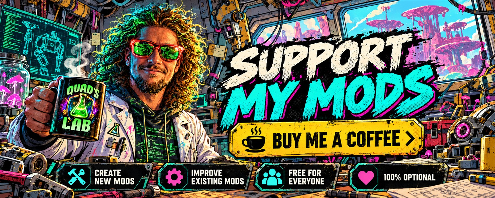

<div align="center">

# 🍄 Mycopunk Mods

**Mods for Mycopunk, the co-op shooter by Pigeons at Play.**
Clean up the dialogue, and more to come.


[](LICENSE.md)
[](https://thunderstore.io/c/mycopunk/)
[](https://discord.gg/EwTjQxEZPy)
[](https://buymeacoffee.com/quadh)

</div>

---

> **Unofficial fan mods.** Not affiliated with or endorsed by Pigeons at Play.

## 🚀 Install

### Option 1: a mod manager, easiest

With **r2modman** or **Gale**, find the mod under Mycopunk on [Thunderstore](https://thunderstore.io/c/mycopunk/) and install
it. It brings BepInEx with it.

### Option 2: by hand

1. **BepInEx:** install [BepInExPack for Mycopunk](https://thunderstore.io/c/mycopunk/p/BepInEx/BepInExPack_Mycopunk/): copy the
   contents of its `BepInExPack_Mycopunk` folder into your Mycopunk folder (next to `Mycopunk.exe`).
2. **The mod:** download its zip from the [releases](https://github.com/HardHeadHackerHead/mycopunk-mods/releases) and unzip it into
   `BepInEx\plugins\`, so you get `BepInEx\plugins\<Mod>\<Mod>.dll`.
3. Start Mycopunk. `BepInEx\LogOutput.log` shows each mod loading, and its settings are in `BepInEx\config\`.

### Option 3: reload mods without restarting (for testing and making mods)

Add **ScriptEngine** to BepInEx and mods load from `BepInEx\scripts`, where a new build reloads in the running game:

1. From [BepInEx.Debug releases](https://github.com/BepInEx/BepInEx.Debug/releases) download `ScriptEngine_*.zip` and copy its
   `BepInEx` folder over yours, so you have `BepInEx\plugins\ScriptEngine.dll`. Create the folder `BepInEx\scripts`.
2. In `BepInEx\config\com.bepis.bepinex.scriptengine.cfg` (start the game once if it isn't there yet) set `LoadOnStart = true`
   under `[General]`, and `EnableFileSystemWatcher = true` under `[AutoReload]` to reload whenever a file there changes.
3. Put each mod's `.dll` (and `.pdb`) straight into `BepInEx\scripts`. **F6** reloads them by hand. A mod goes in `scripts` or in
   `plugins`, never both.

### Removing

- **One mod:** delete its DLL (from `BepInEx\plugins\<Mod>\` or `BepInEx\scripts`).
- **Everything:** delete `BepInEx`, `winhttp.dll`, `doorstop_config.ini` and `.doorstop_version` from the Mycopunk folder. Steam's
  *Verify integrity of game files* doesn't remove them.

## 🧰 The mods

### 🙏 No Blasphemy


Takes **God's name used in vain** out of the dialogue. The subtitles are cleaned ("oh my gosh", "thank goodness"), and those spoken
lines go quiet, since a recording can't lose just one word. Lines that speak of God with respect stay, and the milder swearing is
left alone. Only you need it: it changes only what you hear and read.

**[More: how it works and settings →](mods/NoBlasphemy/README.md)**

## 🧑‍💻 For developers

You need the .NET SDK and the game. BepInEx and HarmonyX come from NuGet, so nothing has to be installed in the game to build.

```powershell
.\scripts\build.ps1                                   # build every mod in mods\
.\scripts\build.ps1 -Mod NoBlasphemy -Deploy          # one mod, copied into the game: BepInEx\scripts with ScriptEngine
                                                      # (it reloads in the running game), else BepInEx\plugins\<Name>\
.\scripts\package.ps1                                 # manual-install zips in build\, for a GitHub release
python scripts\store.py NoBlasphemy                   # the Thunderstore package in build\store\, checked
.\scripts\new-mod.ps1 -Name MyMod -Title "My Mod"     # start a new mod in mods\MyMod\
```

- The game folder defaults to `D:\SteamLibrary\steamapps\common\Mycopunk`; pass `-GameDir` (or set `MYCO_GAMEDIR`) for yours.
  `-PluginsDir` deploys somewhere else, such as a mod manager profile's `BepInEx\plugins`.
- Each mod is a folder under `mods/` with its own `.csproj`, `Plugin.cs`, `README.md` (its page, linked from its card above),
  `CHANGELOG.md`, `LICENSE.md`, `store.json` (its Thunderstore listing) and `icon.png` (256 x 256). Shared build settings are in
  `mods/Directory.Build.props`, so a mod's own `.csproj` is a few lines.
- Bump the `Version` constant in `Plugin.cs` for every change people should get, with a line in `CHANGELOG.md`.
- A mod has to survive a ScriptEngine reload: undo its Harmony patches and destroy what it made in `OnDestroy`.
- Release: `python scripts\store.py <Mod>`, test that zip, then `--publish`.

## 📄 License

**Source-available, not open source**: see [LICENSE.md](LICENSE.md) (each mod carries a copy). You may read the code, play, build it
for yourself, contribute, and share the official releases unmodified and free. You may not release modified versions, copy the code
into your own, or sell it, without written permission. Mods run inside your game with full access to your PC, so only install code
you trust.

**Mycopunk** and all its content belong to [Pigeons at Play](https://store.steampowered.com/app/3247750/Mycopunk/). BepInEx and
HarmonyX belong to their respective authors.

## 🤖 Made with AI

Made with the help of Claude (Anthropic), with Claude Code: designed, written and checked together, and tried in the game. The
Discord and support banners are AI-generated.

## 💬 Join us on Discord

<a href="https://discord.gg/EwTjQxEZPy"></a>

Come hang out with the people who make and play these mods. In the **Quads Lab Discord** you can:

- 🛠️ **Get help** and report bugs straight to us
- 👀 **See new mods first**, and help test them before they're released
- 🗳️ **Suggest ideas** and vote on what we make next
- 🎮 **Find people to play with**, and share your adventures
- 🤖 **Talk AI coding and vibe coding** with people building things with AI, the way these mods are made

**[Join the Quads Lab Discord →](https://discord.gg/EwTjQxEZPy)**

## 🧪 About Quads Lab

Quads Lab is where **Quad H** ([HardHeadHackerHead](https://github.com/HardHeadHackerHead)) builds software with AI, of every kind:
these Mycopunk mods are one of its projects. Each mod is designed by a player, written with [Claude Code](https://claude.com/claude-code)
and tested in the game.

- 🌐 [quadslab.io](https://quadslab.io)
- 🧰 [All my Mycopunk mods](https://github.com/HardHeadHackerHead/mycopunk-mods)
- 💬 [Discord](https://discord.gg/EwTjQxEZPy)
- ☕ [Buy me a coffee](https://buymeacoffee.com/quadh)
- 🐞 Found a bug? [Open an issue on GitHub](https://github.com/HardHeadHackerHead/mycopunk-mods/issues/new/choose)

## ☕ Support my mods

<a href="https://buymeacoffee.com/quadh"></a>

Every Quads Lab mod is free, and it stays that way. If one of them made your game better and you'd like to say thanks, a coffee
helps me make new mods and keep improving the ones you already play. It's 100% optional, and always appreciated!

**[☕ Buy me a coffee →](https://buymeacoffee.com/quadh)**
