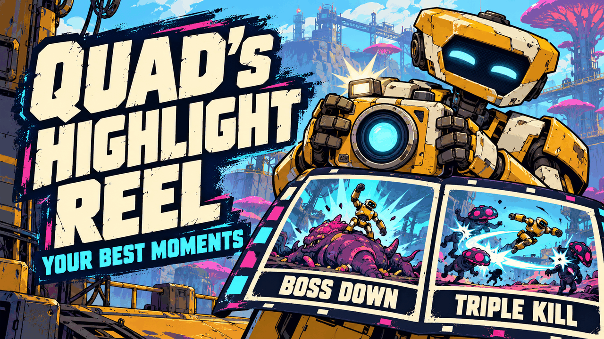
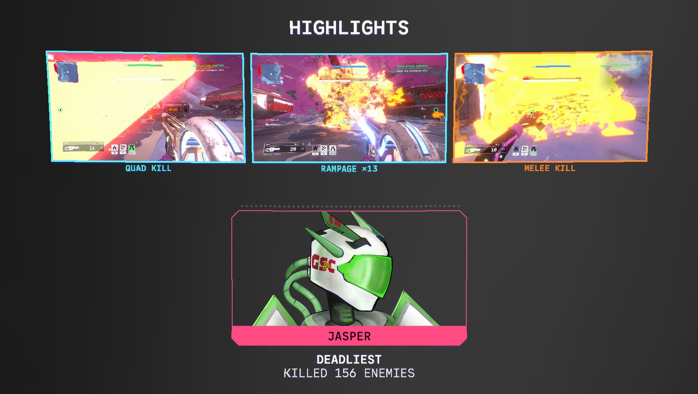
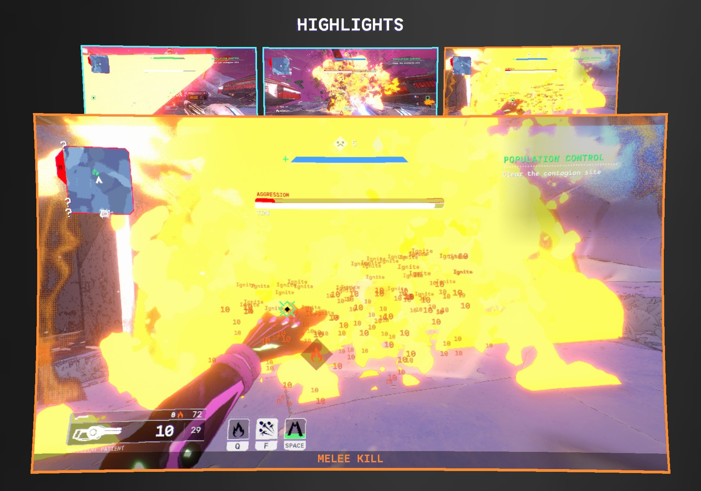

# 📸 Quad's Highlight Reel

**Your best moments, caught for you: boss kills, melee kills, multi-kills, close calls and comebacks are photographed as they happen and shown as a highlight reel when the mission's over. Point at one to see it big. They're saved to your Pictures folder too.**

    

[Source code](https://github.com/HardHeadHackerHead/mycopunk-mods/tree/main/mods/HighlightReel)  ·  [Report a bug](https://github.com/HardHeadHackerHead/mycopunk-mods/issues/new?template=bug.yml&title=%5BQuad%27s%20Highlight%20Reel%5D%20)  ·  [Discord](https://discord.gg/EwTjQxEZPy)

  

<!-- GITHUB-ONLY -->**Install:** see [Install](../../README.md#-install) on the main page: BepInEx, then this mod's DLL in `BepInEx\plugins` (or `BepInEx\scripts` with ScriptEngine).<!-- END GITHUB-ONLY -->

## ✨ Features

You don't have to remember to take screenshots: the mod watches for the moments worth keeping and takes the picture for you, a split second after, so the hit is in it.

### What it catches

| Moment | Caption |
|---|---|
| You kill a boss | **BOSS DOWN** and its name |
| You kill an Abomination | **ABOMINATION DOWN** |
| You kill an enemy with your melee | **MELEE KILL** (one every 15 seconds at most) |
| A burst of kills: 4 or more within 1 second | **QUAD KILL**, **RAMPAGE ×6**... (one picture per burst, its caption going up as the burst does; a rest between bursts, so a horde isn't one endless rampage) |
| Your health dips below 15% and you live through it | **CLOSE CALL** (kept only if you're still up a few seconds later) |
| You're brought back up | **BACK IN THE FIGHT** |

### How it works

- **When the mission's over.** After a successful mission, the awards screen that follows the rewards (your "Deadliest" card and the like) shows a **HIGHLIGHTS** row of big pictures across the top, in the order they happened, each framed in its colour: gold for bosses, orange for melee kills, cyan for multi-kills and close calls. After a failed or aborted mission there's no awards screen, so they show on the reward screen, between your XP and your rewards.
- **Point at one to see it big.** It opens over the middle of the screen, with its caption, until you point away.
- **Saved for you.** When the mission's reward screen opens, the reel is saved as PNGs in your **Pictures** folder, under **Mycopunk Highlights** (or a folder of your own, or not at all: see the settings).
- **A mix of the best six.** A mission keeps up to six: every boss, at most two multi-kills and two melee kills, one close call and one comeback. A new mission starts a new reel.
- **No stutter.** The pictures are taken on the graphics card and saved in the background, so play doesn't hitch.

## 📸 Screenshots

**After a mission: the highlight reel on the awards screen** (real pictures from a Population Control run)

**Pointing at one shows it big: here, a melee kill through a wall of fire**

## 👥 Multiplayer

**Who needs it:** Only you. It photographs your own screen and your own moments.

## ⚙️ Settings

In `BepInEx\config\quadslab.mycopunk.highlightreel.cfg`, made the first time the game runs with the mod. r2modman and Gale edit it under **Config editor**.

**Moments**

| Setting | Default | What it does |
|---|---|---|
| `Bosses` | `true` | A picture when you kill a boss or an Abomination. |
| `MeleeKills` | `true` | A picture when you kill an enemy with your melee (one every 15 seconds at most). |
| `MultiKills` | `true` | A picture when you kill several enemies in a burst (one per burst, a rest between bursts). |
| `MultiKillCount` | `4` | How many kills within `MultiKillWindow` make a multi-kill. |
| `MultiKillWindow` | `1` | Seconds those kills have to fall within (and between the kills that carry a burst on). |
| `CloseCalls` | `true` | A picture when your health dips very low and you live through it. |
| `CloseCallHealth` | `0.15` | How low is "very low" (0.15 = 15% of your health). |
| `Revives` | `true` | A picture when you're brought back up. |

**Reel**

| Setting | Default | What it does |
|---|---|---|
| `MaxShots` | `6` | How many pictures a mission keeps (a mix of the best, bosses first). |
| `SaveToDisk` | `true` | Also save the reel as PNGs when the reward screen opens. |
| `Folder` | (empty) | Where to save them; empty means your Pictures folder, in "Mycopunk Highlights". |

**Debug**

| Setting | Default | What it does |
|---|---|---|
| `TestKey` | `false` | **F8** in the hub takes four sample pictures and opens the reward screen with them (never saved; only in the hub). |

A moment it should have caught, or one it shouldn't have? [Tell us](https://github.com/HardHeadHackerHead/mycopunk-mods/issues/new?template=bug.yml&title=%5BQuad%27s%20Highlight%20Reel%5D%20).

## 🤖 Made with AI

Made with the help of Claude (Anthropic), with Claude Code: designed, written and checked together, and tried in the game. Its cover and icon were made with AI image generation; the screenshots are from the game.

## 💬 Join us on Discord

Come hang out with the people who make and play these mods. In the **Quads Lab Discord** you can:

- 🛠️ **Get help** and report bugs straight to us
- 👀 **See new mods first**, and help test them before they're released
- 🗳️ **Suggest ideas** and vote on what we make next
- 🎮 **Find people to play with**, and share your adventures
- 🤖 **Talk AI coding and vibe coding** with people building things with AI, the way these mods are made

**[Join the Quads Lab Discord →](https://discord.gg/EwTjQxEZPy)**

## 🧪 About Quads Lab

Quads Lab is where **Quad H** ([HardHeadHackerHead](https://github.com/HardHeadHackerHead)) builds software with AI, of every kind:
these Mycopunk mods are one of its projects. Each mod is designed by a player, written with [Claude Code](https://claude.com/claude-code)
and tested in the game.

- 🌐 [quadslab.io](https://quadslab.io)
- 🧰 [All my Mycopunk mods](https://github.com/HardHeadHackerHead/mycopunk-mods)
- 💬 [Discord](https://discord.gg/EwTjQxEZPy)
- ☕ [Buy me a coffee](https://buymeacoffee.com/quadh)
- 🐞 Found a bug? [Open an issue on GitHub](https://github.com/HardHeadHackerHead/mycopunk-mods/issues/new/choose)

## ☕ Support my mods

Every Quads Lab mod is free, and it stays that way. If one of them made your game better and you'd like to say thanks, a coffee
helps me make new mods and keep improving the ones you already play. It's 100% optional, and always appreciated!

**[☕ Buy me a coffee →](https://buymeacoffee.com/quadh)**

## 📜 Recent changes

<!-- RECENT-CHANGES -->
- **0.1.0** First release: pictures of your best moments (bosses, melee kills, multi-kills, close calls, revives) when the mission's over, big when you point at them, and saved to your Pictures folder.
<!-- END RECENT-CHANGES -->

[Every change](CHANGELOG.md)

Unofficial fan mod, not affiliated with Pigeons at Play. License: source-available (see [LICENSE.md](LICENSE.md)).
