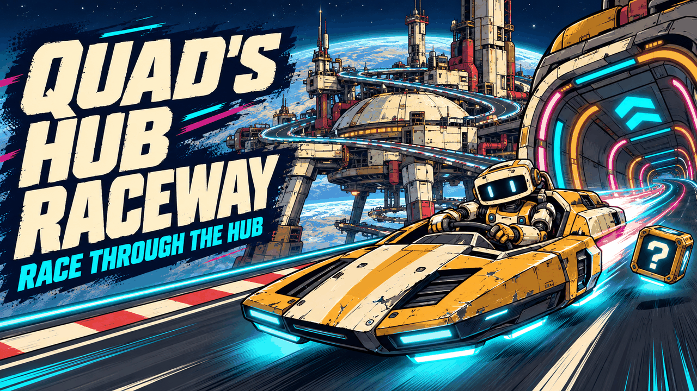
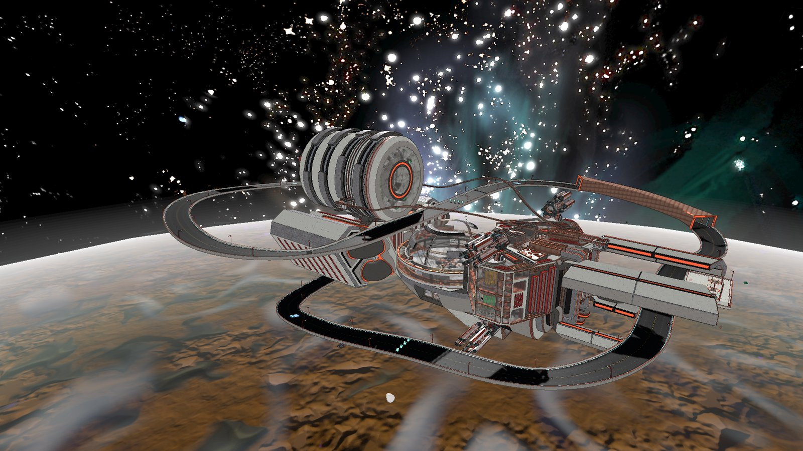
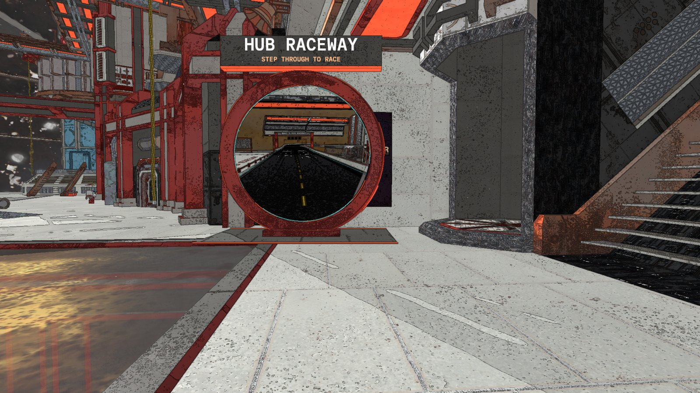
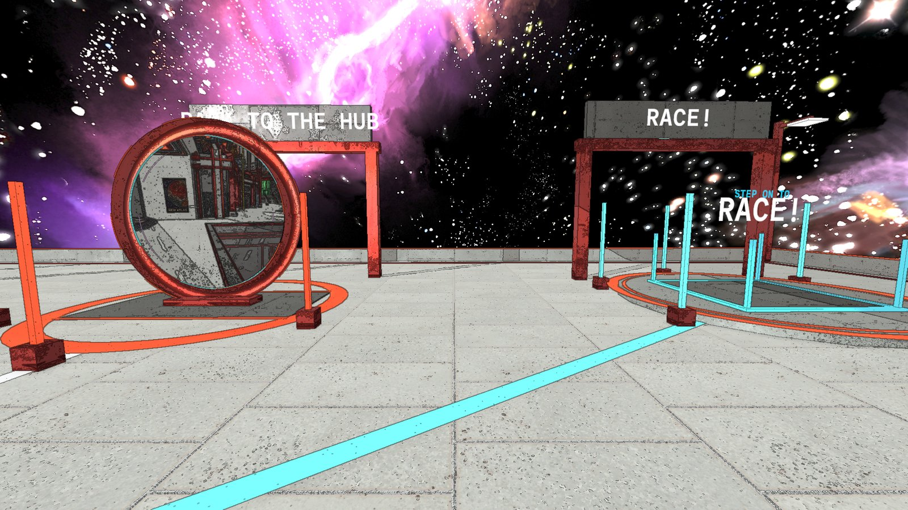
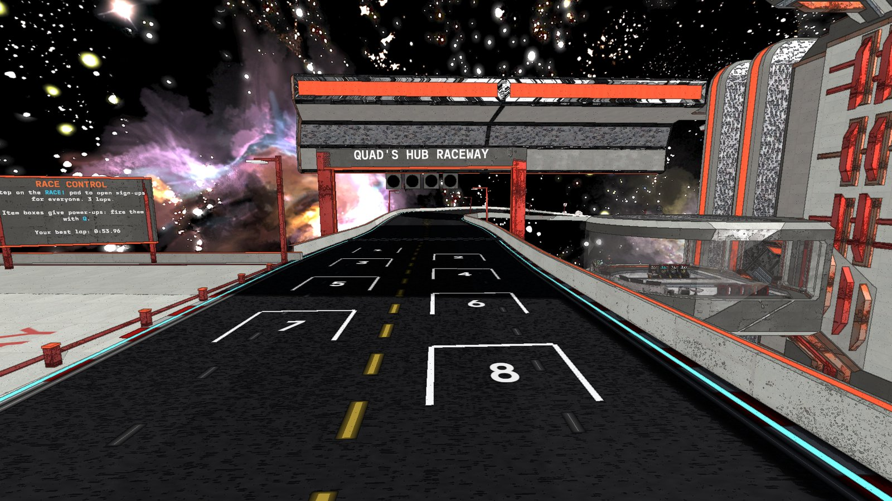
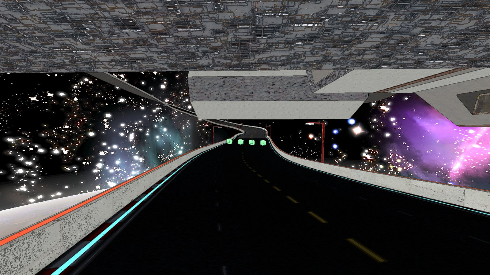
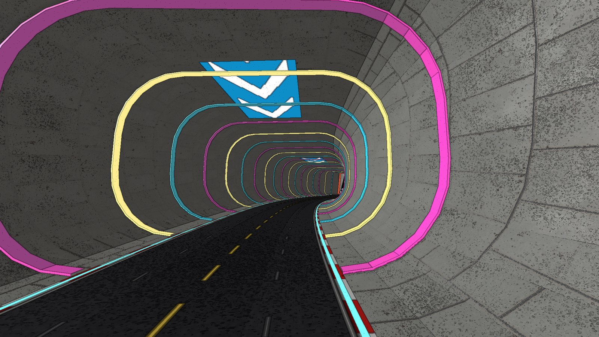
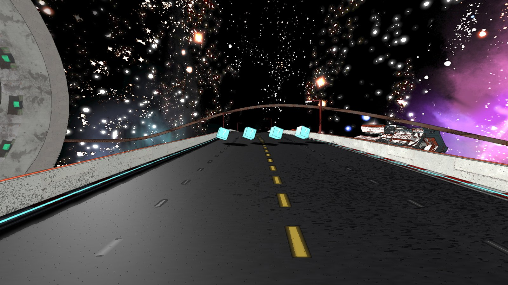

# 🏁 Quad's Hub Raceway

**A racetrack woven right through the H.U.B.: under the station's legs, diving beneath its belly under the great north tower, round the tower's far end and over the dome. Step through the portal (in your car, if you like), ride the walls and ceiling of the light tube, grab power-ups from item boxes, and race your friends with a real start: sign-ups, the grid, red-orange-yellow-green lights and places on your screen.**

    

[Source code](https://github.com/HardHeadHackerHead/mycopunk-mods/tree/main/mods/HubRaceway)  ·  [Report a bug](https://github.com/HardHeadHackerHead/mycopunk-mods/issues/new?template=bug.yml&title=%5BQuad's%20Hub%20Raceway%5D%20)  ·  [Discord](https://discord.gg/EwTjQxEZPy)

  

<!-- GITHUB-ONLY -->**Install:** see [Install](../../README.md#-install) on the main page: BepInEx, then this mod's DLL in `BepInEx\plugins` (or `BepInEx\scripts` with ScriptEngine).<!-- END GITHUB-ONLY -->

## ✨ Features

### The track

- **Through the hub, not beside it.** 3 km a lap: the start straight runs under the station's legs, the road sweeps down past the west wing and dives under the station's belly beneath the north tower and its thrusters, climbs round the tower's far end under its exhaust, flies over the road you came by, crosses over the dome, and comes home through the light tube.
- **The tube.** A big rounded tube ringed with chasing lights. Drive into its curved sides and you stick: ride up the walls and right over the ceiling, where two boost pads wait for whoever gets up there.
- **The station's own look.** Walls, pipes, panels, floor tiles and light strips are the hub's own, so the raceway looks built into it: red-pipe lamp posts and gantry, banked corners, glowing edge lines, kerbs, chevron boards on the sharp corners, and the QUAD'S HUB RACEWAY gantry with its start lights over the painted grid.
- **No falling into space for long.** Drive off the edge and you're put back on the road where you left it, still in your car.

### Getting there

- **The portal.** It stands by the Navigation Deck, flat on the floor, framed in the hub's red pipe, with a live picture of the start straight in it. Walk through and you land on the paddock; drive through and you and your car land behind the grid (passengers come too).
- **The launch deck.** An open deck beside the start straight, under the station's legs, with the stars all round. You land on the **ARRIVALS** ring facing three stations under red archways, glowing stripes leading to each: step on the **YOUR CAR** pad and your own car appears on the track with you in the driver's seat; the **BACK TO THE HUB** portal (showing the hub) takes you home; the **RACE!** pad opens a race. The race board stands at the end of the deck by the start gantry.

### Power-ups

- **Item boxes.** Three rows of spinning boxes across the road. Drive through one for a random power-up; fire it with **Q** (your throw key). In a race, the further back you are, the better your odds.
- **TURBO** (and **TRIPLE TURBO**): a burst of speed and glowing trails. **OIL SLICK**: splashed behind you; whoever hits it spins out. **HOMING ZAP**: a glowing orb that chases down the racer ahead. **SHOCKWAVE**: a ring of lightning you can see spread out, slowing every other driver. **STAR SHIELD**: speed, spinning rings round your car, and nothing can hit you for a few seconds.
- **You see it all.** Boxes burst when you grab them, hits flash and ring out, and everyone else sees your turbos, zaps, shockwaves and shield too.
- **Boost pads.** Glowing arrows on the road (and on the tube's ceiling): drive over them for a free turbo.

### Races

- **Sign up.** Step on the **RACE!** pad on the launch deck: sign-ups open for 20 seconds, and everyone in the hub sees the call. Anyone who steps on the pad is in (up to 8).
- **The start.** Everyone signed up is put on their grid slot in their car and held there while the lights go red, orange, yellow... then green: GO!
- **Places.** Your place, lap and time at the top of your screen, everyone's standings down the side, a finish order, and the results on screen and on the race board.
- **Practice.** The rest of the time, cross the line for a practice lap: the timer shows your last and best laps, and your best is kept between games.

## 📸 Screenshots

**The track, looping round, under and over the H.U.B. in orbit**

**The portal by the Navigation Deck, with a live picture of the start straight in it**

**The launch deck where you arrive: your car, the portal home, a race**

**The start: the gantry with its four start lights over the painted grid, the race board beside it**

**Under the station's belly, beneath the north tower**

**The light tube: drive up its walls and over its ceiling for the boost pad up there**

**Item boxes across the road over the dome**

## 👥 Multiplayer

**Who needs it:** Everyone who wants to drive the track. Each player's game builds the track itself, so a player without the mod sees no track (and your car driving on nothing). Races and power-ups that reach other players go through the host, so **the host needs it** for those.

## ⚙️ Settings

In `BepInEx\config\quadslab.mycopunk.hubraceway.cfg`, made the first time the game runs with the mod. r2modman and Gale edit it under **Config editor**.

**Raceway**

- `PortalPosition`: where the portal stands in the hub, as `x, y, z, facing` (facing in degrees: the way you walk through it). Empty (the default): by the Navigation Deck. It shrinks to fit under a low ceiling.
- `RaceLaps` (default `3`): how many laps a race is, when you're the host.

**Debug**

- `TestFiles` (default off): for testing, files in the BepInEx folder act in the hub: `hubraceway-go.txt` takes you to the track, `hubraceway-back.txt` back to the portal, `hubraceway-car.txt` brings your car, `hubraceway-portal.txt` moves the portal in front of where you stand (and saves it as `PortalPosition`), and `hubraceway-photo.txt` takes pictures without the HUD (lines of `name x y z yaw pitch [fov]`, saved in `BepInEx\hubraceway-photos`).

Your best practice lap is in `BepInEx\config\quadslab.mycopunk.hubraceway.times.txt`.

## 🤖 Made with AI

Made with the help of Claude (Anthropic), with Claude Code: designed, written and checked together, and tried in the game. Its cover and icon were made with AI image generation; the screenshots are from the game.

## 💬 Join us on Discord

Come hang out with the people who make and play these mods. In the **Quads Lab Discord** you can:

- 🛠️ **Get help** and report bugs straight to us
- 👀 **See new mods first**, and help test them before they're released
- 🗳️ **Suggest ideas** and vote on what we make next
- 🎮 **Find people to play with**, and share your adventures
- 🤖 **Talk AI coding and vibe coding** with people building things with AI, the way these mods are made

**[Join the Quads Lab Discord →](https://discord.gg/EwTjQxEZPy)**

## 🧪 About Quads Lab

Quads Lab is where **Quad H** ([HardHeadHackerHead](https://github.com/HardHeadHackerHead)) builds software with AI, of every kind:
these Mycopunk mods are one of its projects. Each mod is designed by a player, written with [Claude Code](https://claude.com/claude-code)
and tested in the game.

- 🌐 [quadslab.io](https://quadslab.io)
- 🧰 [All my Mycopunk mods](https://github.com/HardHeadHackerHead/mycopunk-mods)
- 💬 [Discord](https://discord.gg/EwTjQxEZPy)
- ☕ [Buy me a coffee](https://buymeacoffee.com/quadh)
- 🐞 Found a bug? [Open an issue on GitHub](https://github.com/HardHeadHackerHead/mycopunk-mods/issues/new/choose)

## ☕ Support my mods

Every Quads Lab mod is free, and it stays that way. If one of them made your game better and you'd like to say thanks, a coffee
helps me make new mods and keep improving the ones you already play. It's 100% optional, and always appreciated!

**[☕ Buy me a coffee →](https://buymeacoffee.com/quadh)**

## 📜 Recent changes

<!-- RECENT-CHANGES -->
- **0.1.0** First release: a 3 km track woven through the hub (under its legs, under its belly beneath the north tower, round the tower, over the dome), in the hub's own look, with a light tube whose walls and ceiling you can drive. A portal in the hub (walk or drive through), and a launch deck where you arrive: a pad that brings your car, a race pad, the race board, the portal home. Power-ups from item boxes (turbo, triple turbo, oil slick, homing zap, shockwave, star shield), fired with Q, with effects everyone sees; boost pads on the road and the tube's ceiling. Races for everyone: sign-ups, the grid, start lights, places, a finish order and results. Practice laps with your best kept.
<!-- END RECENT-CHANGES -->

[Every change](CHANGELOG.md)

Unofficial fan mod, not affiliated with Pigeons at Play. License: source-available (see [LICENSE.md](LICENSE.md)).
