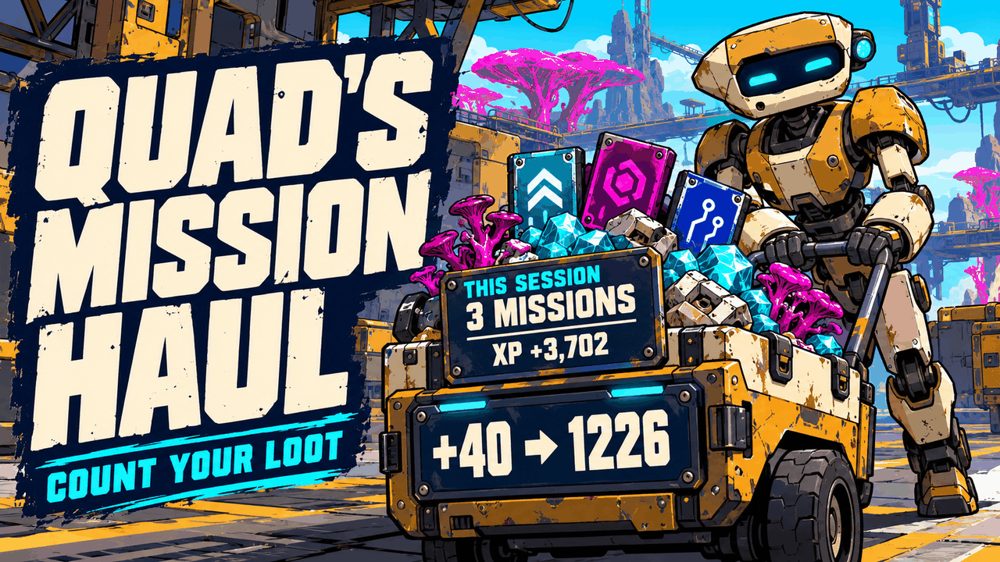
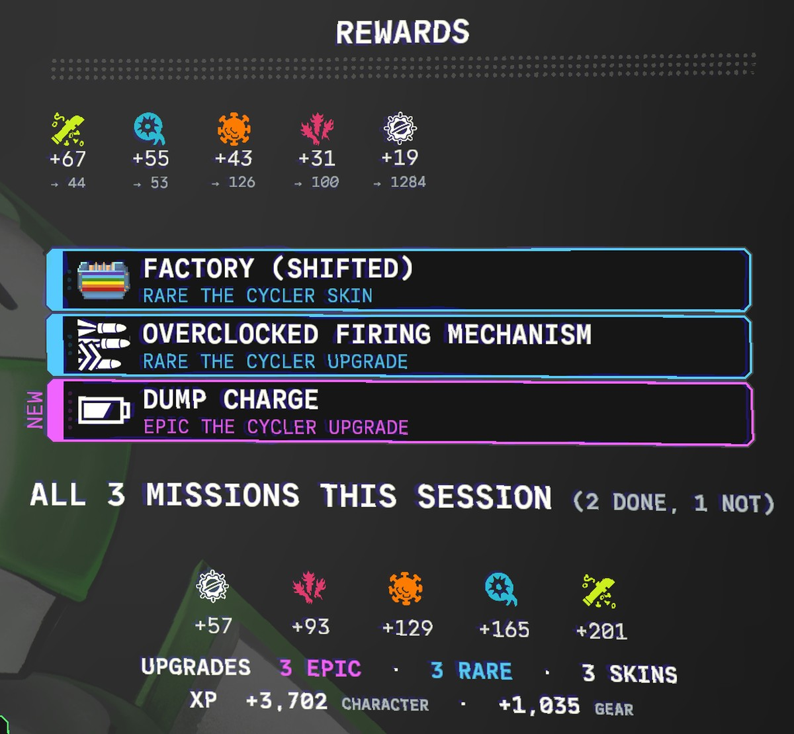

# 📦 Quad's Mission Haul

**Count your loot: on the mission reward screen, each resource you earned shows its new total ("+40 → 1226"), and from your second mission on, a panel adds up what all your missions this session have paid out.**

    

[Source code](https://github.com/HardHeadHackerHead/mycopunk-mods/tree/main/mods/MissionHaul)  ·  [Report a bug](https://github.com/HardHeadHackerHead/mycopunk-mods/issues/new?template=bug.yml&title=%5BQuad%27s%20Mission%20Haul%5D%20)  ·  [Discord](https://discord.gg/EwTjQxEZPy)

  

<!-- GITHUB-ONLY -->**Install:** see [Install](../../README.md#-install) on the main page: BepInEx, then this mod's DLL in `BepInEx\plugins` (or `BepInEx\scripts` with ScriptEngine).<!-- END GITHUB-ONLY -->

## ✨ Features

The game's reward screen tells you what a mission paid ("+40"). This mod adds where that leaves you, and how your whole session is going.

### How it works

- **Your new totals.** Under each resource you earned, a smaller grey line shows how much you have now: **+98 → 1284**.
- **All your missions this session.** From your second mission on, a panel below the rewards and upgrades adds up every mission since you started the game, under **ALL 5 MISSIONS THIS SESSION**: how many didn't go to plan, every resource earned, upgrades found by rarity (and skins), and character and gear XP. It's a running total, not another reward: after your first mission it would only repeat the rewards above, so it waits for the second.
- **A session is one sitting.** It starts when you start the game and keeps counting until you quit.
- **Nothing changes in your game.** It only reads the rewards the game already gives you.

## 📸 Screenshots

**The reward screen: each resource's new total under it, and all the session's missions added up below the upgrades** (the mod's test screen, with sample rewards: a real total is never lower than what you just earned)

## 👥 Multiplayer

**Who needs it:** Only you. It counts your own rewards and only changes what your screen shows.

## ⚙️ Settings

In `BepInEx\config\quadslab.mycopunk.missionhaul.cfg`, made the first time the game runs with the mod. r2modman and Gale edit it under **Config editor**.

**General**

| Setting | Default | What it does |
|---|---|---|
| `ShowTotals` | `true` | Show each resource's new total under what you earned. |
| `ShowSession` | `true` | From your second mission on, show all this session's missions added up below the mission's rewards. |

**Debug**

| Setting | Default | What it does |
|---|---|---|
| `TestKey` | `false` | **F8** in the hub opens the reward screen with sample rewards, to look at it without playing a mission (never counted in your session; only in the hub). |
| `LogLayout` | `false` | Write where the reward screen's parts are to the BepInEx log. |

Lots of upgrades in one mission, or something overlapping? [Tell us](https://github.com/HardHeadHackerHead/mycopunk-mods/issues/new?template=bug.yml&title=%5BQuad%27s%20Mission%20Haul%5D%20) with a screenshot.

## 🤖 Made with AI

Made with the help of Claude (Anthropic), with Claude Code: designed, written and checked together, and tried in the game. Its cover and icon were made with AI image generation; the screenshot is from the game (the mod's test screen, with sample rewards).

## 💬 Join us on Discord

Come hang out with the people who make and play these mods. In the **Quads Lab Discord** you can:

- 🛠️ **Get help** and report bugs straight to us
- 👀 **See new mods first**, and help test them before they're released
- 🗳️ **Suggest ideas** and vote on what we make next
- 🎮 **Find people to play with**, and share your adventures
- 🤖 **Talk AI coding and vibe coding** with people building things with AI, the way these mods are made

**[Join the Quads Lab Discord →](https://discord.gg/EwTjQxEZPy)**

## 🧪 About Quads Lab

Quads Lab is where **Quad H** ([HardHeadHackerHead](https://github.com/HardHeadHackerHead)) builds software with AI, of every kind:
these Mycopunk mods are one of its projects. Each mod is designed by a player, written with [Claude Code](https://claude.com/claude-code)
and tested in the game.

- 🌐 [quadslab.io](https://quadslab.io)
- 🧰 [All my Mycopunk mods](https://github.com/HardHeadHackerHead/mycopunk-mods)
- 💬 [Discord](https://discord.gg/EwTjQxEZPy)
- ☕ [Buy me a coffee](https://buymeacoffee.com/quadh)
- 🐞 Found a bug? [Open an issue on GitHub](https://github.com/HardHeadHackerHead/mycopunk-mods/issues/new/choose)

## ☕ Support my mods

Every Quads Lab mod is free, and it stays that way. If one of them made your game better and you'd like to say thanks, a coffee
helps me make new mods and keep improving the ones you already play. It's 100% optional, and always appreciated!

**[☕ Buy me a coffee →](https://buymeacoffee.com/quadh)**

## 📜 Recent changes

<!-- RECENT-CHANGES -->
- **0.1.1** Counts only the game's own reward screens: another mod's test screen (Highlight Reel's) is never added to your session.
- **0.1.0** First release: each resource's new total on the mission reward screen, and from your second mission on, all this session's missions added up below it.
<!-- END RECENT-CHANGES -->

[Every change](CHANGELOG.md)

Unofficial fan mod, not affiliated with Pigeons at Play. License: source-available (see [LICENSE.md](LICENSE.md)).
