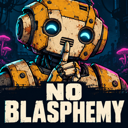

# 🙏 Quad's No Blasphemy

**Clean dialogue for Mycopunk: takes God's name used in vain out of what the characters say, in every language. The subtitles are cleaned, and those spoken lines are swapped for clean ones or go quiet. Lines that speak of God with respect stay.**

    

[Source code](https://github.com/HardHeadHackerHead/mycopunk-mods/tree/main/mods/NoBlasphemy)  ·  [Report a bug](https://github.com/HardHeadHackerHead/mycopunk-mods/issues/new?template=bug.yml&title=%5BQuad%27s%20No%20Blasphemy%5D%20)  ·  [Discord](https://discord.gg/EwTjQxEZPy)

  

<!-- GITHUB-ONLY -->**Install:** see [Install](../../README.md#-install) on the main page: BepInEx, then this mod's DLL in `BepInEx\plugins` (or `BepInEx\scripts` with ScriptEngine).<!-- END GITHUB-ONLY -->

## ✨ Features

The crew, Roachard, Hunk and the rest stop using the Lord's name as a curse or an exclamation, in what you hear and in what you read.

### How it works

- **Subtitles are cleaned.** The name becomes a harmless word: "oh my G--!" reads "oh my gosh!", "thank G--" reads "thank goodness", and the G-- d--- curse reads "dang".
- **Those spoken lines are swapped, or go quiet.** A recording can't lose a single word. So when the game picks a line at random from several for the same moment (a call for help, Roachard's chatter, "upload complete"), it picks a clean one instead. A line the game plays in a set order (conversations, story moments) is silenced, and only its cleaned subtitle shows. Conversations and mission chatter carry on around it at the normal pace.
- **Respectful lines stay.** When a character speaks of God sincerely (the Wrangler on faith, and on the Lord being a carpenter), it's left as it is, in every language.
- **New dialogue is covered too.** The mod finds the lines by their words, so lines added by game updates are caught. Right now that's 21 spoken lines across the crew, mission control and the side characters, plus a few translated subtitles that use the name where the English doesn't.
- **Only God's name.** The milder swearing is left alone.

## 👥 Multiplayer

**Who needs it:** Only you. It changes only what you hear and read, so you can play with anyone, with or without it.

## 🌍 Languages

All of the game's languages: **English, Français, Deutsch, Español, Русский, Português, 简体中文, 繁體中文, 日本語, 한국어.** The subtitles are cleaned in the language you play in, with that language's everyday words ("oh là là", "meine Güte", "madre mía", "ох", "minha nossa", "我的天", "なんてこった", "세상에"). The voices are in English in every language, so the same lines are swapped or silenced whatever language you play in.

The translations were checked line by line, but if one reads oddly, [tell us](https://github.com/HardHeadHackerHead/mycopunk-mods/issues/new?template=bug.yml&title=%5BQuad%27s%20No%20Blasphemy%5D%20Translation%3A%20) the better words.

## ⚙️ Settings

In `BepInEx\config\quadslab.mycopunk.noblasphemy.cfg`, made the first time the game runs with the mod. r2modman and Gale edit it under **Config editor**.

**General**

| Setting | Default | What it does |
|---|---|---|
| `MuteVoice` | `true` | Silence the spoken lines that can't be swapped. Off: you'd still hear them, with clean subtitles. |
| `CleanSubtitles` | `true` | Clean the subtitles, in every language. |
| `SwapLines` | `true` | When a line is picked at random from several for the same moment, pick a clean one instead. |

**Lines**

| Setting | Default | What it does |
|---|---|---|
| `Keep` | (empty) | More line IDs to leave alone, comma-separated. The sincere lines are always kept. |
| `Extra` | (empty) | More line IDs to clean and silence, for a line the word list misses. |

**Debug**

| Setting | Default | What it does |
|---|---|---|
| `LogLines` | `false` | Write each changed line, with its ID, to `BepInEx\LogOutput.log`, and each line as it's silenced. |
| `TestKey` | `false` | **F8** in a game plays the next changed line, as mission control would say it: you see its cleaned subtitle and hear nothing. |

Heard one we missed? [Tell us](https://github.com/HardHeadHackerHead/mycopunk-mods/issues/new?template=bug.yml&title=%5BQuad%27s%20No%20Blasphemy%5D%20)
which character said it and roughly when, and we'll add it.

## 🤖 Made with AI

Made with the help of Claude (Anthropic), with Claude Code: designed, written and checked together, and tried in the game. Its icon was made with AI image generation.

## 💬 Join us on Discord

Come hang out with the people who make and play these mods. In the **Quads Lab Discord** you can:

- 🛠️ **Get help** and report bugs straight to us
- 👀 **See new mods first**, and help test them before they're released
- 🗳️ **Suggest ideas** and vote on what we make next
- 🎮 **Find people to play with**, and share your adventures
- 🤖 **Talk AI coding and vibe coding** with people building things with AI, the way these mods are made

**[Join the Quads Lab Discord →](https://discord.gg/EwTjQxEZPy)**

## 🧪 About Quads Lab

Quads Lab is where **Quad H** ([HardHeadHackerHead](https://github.com/HardHeadHackerHead)) builds software with AI, of every kind:
these Mycopunk mods are one of its projects. Each mod is designed by a player, written with [Claude Code](https://claude.com/claude-code)
and tested in the game.

- 🌐 [quadslab.io](https://quadslab.io)
- 🧰 [All my Mycopunk mods](https://github.com/HardHeadHackerHead/mycopunk-mods)
- 💬 [Discord](https://discord.gg/EwTjQxEZPy)
- ☕ [Buy me a coffee](https://buymeacoffee.com/quadh)
- 🐞 Found a bug? [Open an issue on GitHub](https://github.com/HardHeadHackerHead/mycopunk-mods/issues/new/choose)

## ☕ Support my mods

Every Quads Lab mod is free, and it stays that way. If one of them made your game better and you'd like to say thanks, a coffee
helps me make new mods and keep improving the ones you already play. It's 100% optional, and always appreciated!

**[☕ Buy me a coffee →](https://buymeacoffee.com/quadh)**

## 📜 Recent changes

<!-- RECENT-CHANGES -->
- **1.0.0** First release: God's name used in vain taken out of the dialogue, in every language: the subtitles cleaned, the voice lines swapped for clean ones or silenced.
<!-- END RECENT-CHANGES -->

[Every change](CHANGELOG.md)

Unofficial fan mod, not affiliated with Pigeons at Play. License: source-available (see [LICENSE.md](LICENSE.md)).
