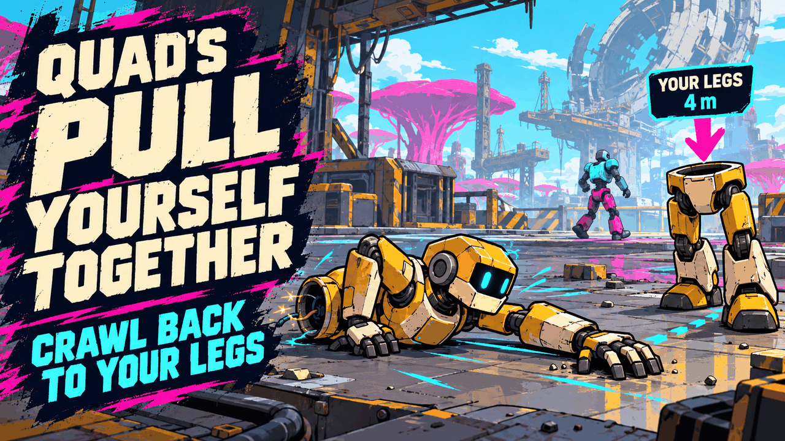
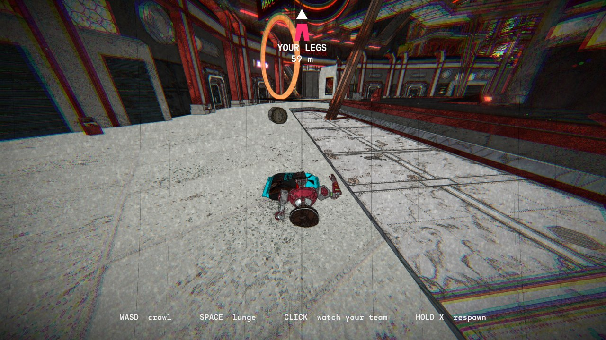

# 🦾 Quad's Pull Yourself Together

**When your robot dies it comes apart, torso and legs. Now you don't have to lie there and wait: drag your torso back to your legs on your own two arms and get back in the fight. And if two of you are down at once, you can be put back together wrong: one of you walks, the other shoots.**

    

[Source code](https://github.com/HardHeadHackerHead/mycopunk-mods/tree/main/mods/PullYourselfTogether)  ·  [Report a bug](https://github.com/HardHeadHackerHead/mycopunk-mods/issues/new?template=bug.yml&title=%5BQuad%27s%20Pull%20Yourself%20Together%5D%20)  ·  [Discord](https://discord.gg/EwTjQxEZPy)

  

<!-- GITHUB-ONLY -->**Install:** see [Install](../../README.md#-install) on the main page: BepInEx, then this mod's DLL in `BepInEx\plugins` (or `BepInEx\scripts` with ScriptEngine).<!-- END GITHUB-ONLY -->

## ✨ Features

In Mycopunk, dying splits your robot in two: a torso and a pair of legs, flung apart, and your team has to carry them back together. This mod keeps all of that, and gives you something to do while you wait.

### Crawl back to your legs

- **Your torso crawls.** The moment you go down, the camera drops in low behind your torso and you drive it: it lies on its front and pulls itself along with its arms, one reaching ahead while the other drags back, an army crawl, your own robot, skin and hat and all.
- **Find your legs.** One big marker shows **YOUR LEGS** and how far they are. When they're behind you or off the screen, it waits at the edge of the screen with an arrow pointing the way.
- **A clean screen.** While you crawl, the death screen's text, the mission list and every other marker are put away, so it's just you, the floor and your legs. They all come back the moment you stop.
- **Reach them and you're back.** Get your torso next to your legs and the game's own repair puts you back together, the same as when a teammate carries you there.
- **Your team still helps.** Teammates can pick your torso up and carry or throw it, just like before. Crawling is slow next to a teammate's sprint.
- **Lunge.** Stuck on a step or a lip? Lunge up and forward over it.
- It follows the ground: up small steps, along walls, down slopes. If the floor drops away under it, it falls like any dropped piece.

| Key | What it does |
|---|---|
| **W A S D** (left stick) | Crawl, the way the camera faces |
| **Mouse** (right stick) | Turn the camera |
| **Space** (A) | Lunge up and forward |
| **Click** (right trigger) | Watch a teammate instead (and back to your torso) |

### Put back together wrong

When two players are down at the same time and one's torso reaches the other one's legs (crawled there, carried there or thrown there), they get put back together as **one robot**:

- **The legs player walks it.** They move, jump and steer, but they have no arms: no weapons, nothing to carry.
- **The torso player rides on top.** They look and shoot wherever they like, and the robot's waist twists round to face where they're aiming.
- **It comes apart again** after a minute, as soon as either of you holds **H**, or the moment either of you goes down.

It only happens when a torso meets **someone else's** legs; your own legs always put you back together right.

## 📸 Screenshots

**Down, and crawling back: the torso drags itself along, and the marker shows where its legs landed**

## 👥 Multiplayer

**Who needs it:** whoever wants to crawl, and the host.

- **To crawl:** you need it. If the host has it too, your torso crawls smoothly. If the host doesn't, it still gets there, flopping along in little hops.
- **To see someone crawl:** players without it see their torso piece slide along the floor, without the arm-by-arm crawl.
- **To be put back together wrong:** the host and both of the players being mixed up need it. Without that, nothing mixes up.

## ⚙️ Settings

In `BepInEx\config\quadslab.mycopunk.pullyourselftogether.cfg`, made the first time the game runs with the mod. r2modman and Gale edit it under **Config editor**.

**Crawling**

| Setting | Default | What it does |
|---|---|---|
| `Enabled` | `true` | Crawl your torso back to your legs when you die. |
| `CrawlSpeed` | `2.4` | How fast a torso crawls, in metres a second (the host's setting counts). |
| `LookSensitivity` | `0.1` | How fast the mouse turns the crawling camera. |

**Mix-ups**

| Setting | Default | What it does |
|---|---|---|
| `Enabled` | `true` | Two downed players can be put back together wrong (the host's setting counts). |
| `Seconds` | `60` | How long a mixed-up robot holds together before it comes apart by itself (the host's setting counts). |
| `SplitKey` | `H` | Hold it to pull a mixed-up robot apart early. |

Something not crawling the way it should? [Tell us](https://github.com/HardHeadHackerHead/mycopunk-mods/issues/new?template=bug.yml&title=%5BQuad%27s%20Pull%20Yourself%20Together%5D%20).

## 🤖 Made with AI

Made with the help of Claude (Anthropic), with Claude Code: designed, written and checked together, and tried in the game. Its cover and icon were made with AI image generation; the screenshot is from the game.

## 💬 Join us on Discord

Come hang out with the people who make and play these mods. In the **Quads Lab Discord** you can:

- 🛠️ **Get help** and report bugs straight to us
- 👀 **See new mods first**, and help test them before they're released
- 🗳️ **Suggest ideas** and vote on what we make next
- 🎮 **Find people to play with**, and share your adventures
- 🤖 **Talk AI coding and vibe coding** with people building things with AI, the way these mods are made

**[Join the Quads Lab Discord →](https://discord.gg/EwTjQxEZPy)**

## 🧪 About Quads Lab

Quads Lab is where **Quad H** ([HardHeadHackerHead](https://github.com/HardHeadHackerHead)) builds software with AI, of every kind:
these Mycopunk mods are one of its projects. Each mod is designed by a player, written with [Claude Code](https://claude.com/claude-code)
and tested in the game.

- 🌐 [quadslab.io](https://quadslab.io)
- 🧰 [All my Mycopunk mods](https://github.com/HardHeadHackerHead/mycopunk-mods)
- 💬 [Discord](https://discord.gg/EwTjQxEZPy)
- ☕ [Buy me a coffee](https://buymeacoffee.com/quadh)
- 🐞 Found a bug? [Open an issue on GitHub](https://github.com/HardHeadHackerHead/mycopunk-mods/issues/new/choose)

## ☕ Support my mods

Every Quads Lab mod is free, and it stays that way. If one of them made your game better and you'd like to say thanks, a coffee
helps me make new mods and keep improving the ones you already play. It's 100% optional, and always appreciated!

**[☕ Buy me a coffee →](https://buymeacoffee.com/quadh)**

## 📜 Recent changes

<!-- RECENT-CHANGES -->
- **0.1.0** First release: crawl your torso back to your legs when you die, and get put back together wrong when two of you are down.
<!-- END RECENT-CHANGES -->

[Every change](CHANGELOG.md)

Unofficial fan mod, not affiliated with Pigeons at Play. License: source-available (see [LICENSE.md](LICENSE.md)).
