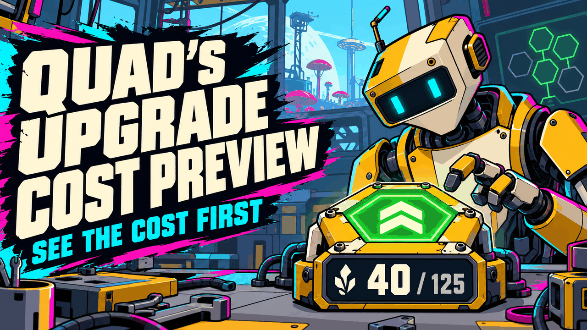
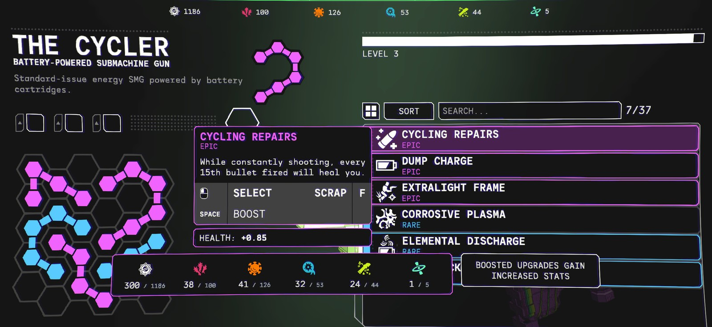

# 🔍 Quad's Upgrade Cost Preview

**See what an upgrade costs before you spend it: the turbocharge cost shows as soon as you point at an upgrade, and every cost shows against how much you have ("300 / 1186").**

    

[Source code](https://github.com/HardHeadHackerHead/mycopunk-mods/tree/main/mods/UpgradeCostPreview)  ·  [Report a bug](https://github.com/HardHeadHackerHead/mycopunk-mods/issues/new?template=bug.yml&title=%5BQuad%27s%20Upgrade%20Cost%20Preview%5D%20)  ·  [Discord](https://discord.gg/EwTjQxEZPy)

  

<!-- GITHUB-ONLY -->**Install:** see [Install](../../README.md#-install) on the main page: BepInEx, then this mod's DLL in `BepInEx\plugins` (or `BepInEx\scripts` with ScriptEngine).<!-- END GITHUB-ONLY -->

## ✨ Features

In the Gear screen, turbocharging (boosting) an upgrade means holding a key, and the game hides what it costs until you start holding: then it just counts your resources down. With this mod you see the price first.

### How it works

- **The turbocharge cost shows straight away.** Point at an upgrade you own and its boost cost is in the info panel, before you press anything.
- **Every cost against what you have.** Each resource reads like **300 / 1186**: what it costs, then a smaller grey "/ what you have". The cost still turns red when you can't afford it. This applies to every hold-to-spend cost in the info panel (unlocking, boosting), not only turbocharging.
- **Room to read.** The costs are spread out so the numbers don't run into each other; big amounts are shortened (12.3k, 1.2M).
- **Holding works as before.** Hold the key and the cost counts down as usual.

## 📸 Screenshots

**Pointing at an Epic upgrade: the boost cost is already showing, each resource against what you have**

## 👥 Multiplayer

**Who needs it:** Only you. It only changes what your screen shows.

## ⚙️ Settings

In `BepInEx\config\quadslab.mycopunk.upgradecostpreview.cfg`, made the first time the game runs with the mod. r2modman and Gale edit it under **Config editor**.

**General**

| Setting | Default | What it does |
|---|---|---|
| `ShowTurbochargeCost` | `true` | Show the turbocharge cost as soon as you point at an upgrade. |
| `ShowOwned` | `true` | Show each cost against how much you have ("300 / 1186"). |

Something not showing right, or clashing with another mod's upgrade screen? [Tell us](https://github.com/HardHeadHackerHead/mycopunk-mods/issues/new?template=bug.yml&title=%5BQuad%27s%20Upgrade%20Cost%20Preview%5D%20).

## 🤖 Made with AI

Made with the help of Claude (Anthropic), with Claude Code: designed, written and checked together, and tried in the game. Its cover and icon were made with AI image generation; the screenshot is from the game.

## 💬 Join us on Discord

Come hang out with the people who make and play these mods. In the **Quads Lab Discord** you can:

- 🛠️ **Get help** and report bugs straight to us
- 👀 **See new mods first**, and help test them before they're released
- 🗳️ **Suggest ideas** and vote on what we make next
- 🎮 **Find people to play with**, and share your adventures
- 🤖 **Talk AI coding and vibe coding** with people building things with AI, the way these mods are made

**[Join the Quads Lab Discord →](https://discord.gg/EwTjQxEZPy)**

## 🧪 About Quads Lab

Quads Lab is where **Quad H** ([HardHeadHackerHead](https://github.com/HardHeadHackerHead)) builds software with AI, of every kind:
these Mycopunk mods are one of its projects. Each mod is designed by a player, written with [Claude Code](https://claude.com/claude-code)
and tested in the game.

- 🌐 [quadslab.io](https://quadslab.io)
- 🧰 [All my Mycopunk mods](https://github.com/HardHeadHackerHead/mycopunk-mods)
- 💬 [Discord](https://discord.gg/EwTjQxEZPy)
- ☕ [Buy me a coffee](https://buymeacoffee.com/quadh)
- 🐞 Found a bug? [Open an issue on GitHub](https://github.com/HardHeadHackerHead/mycopunk-mods/issues/new/choose)

## ☕ Support my mods

Every Quads Lab mod is free, and it stays that way. If one of them made your game better and you'd like to say thanks, a coffee
helps me make new mods and keep improving the ones you already play. It's 100% optional, and always appreciated!

**[☕ Buy me a coffee →](https://buymeacoffee.com/quadh)**

## 📜 Recent changes

<!-- RECENT-CHANGES -->
- **0.1.0** First release: the turbocharge cost shown before you hold the key, and every cost against how much you have.
<!-- END RECENT-CHANGES -->

[Every change](CHANGELOG.md)

Unofficial fan mod, not affiliated with Pigeons at Play. License: source-available (see [LICENSE.md](LICENSE.md)).
